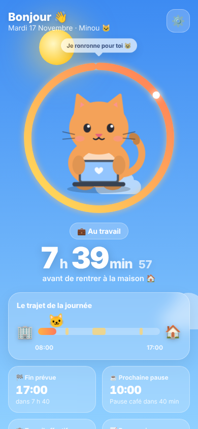
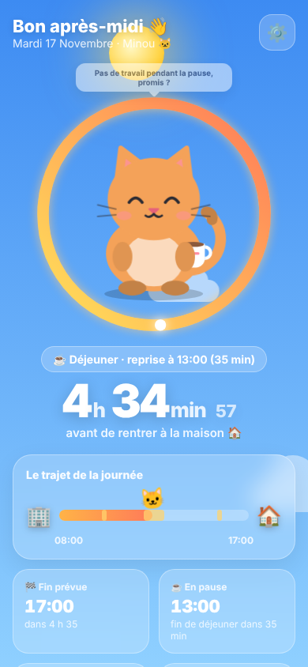
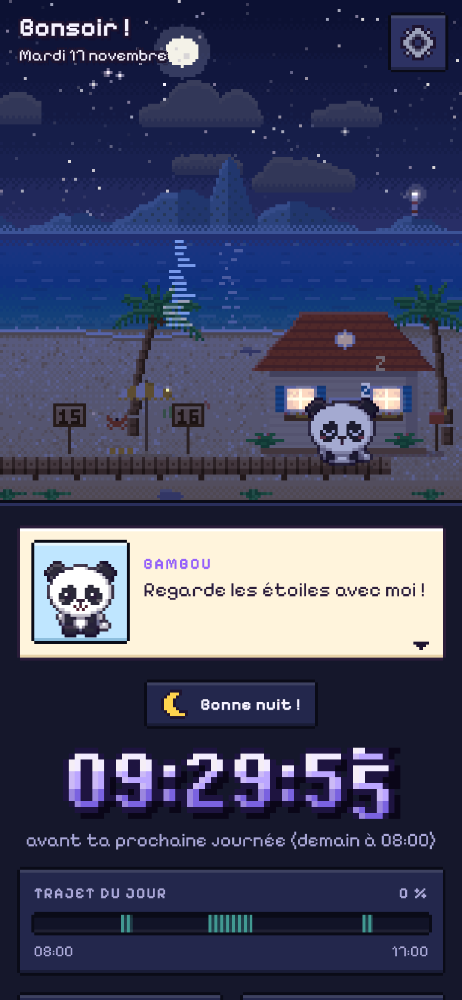
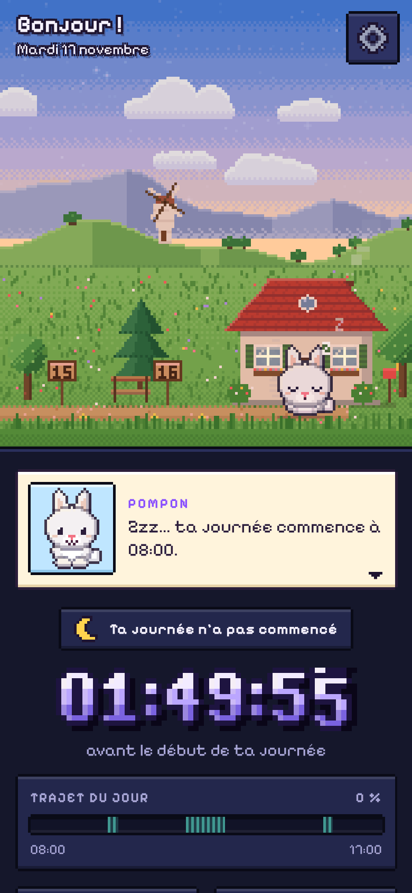
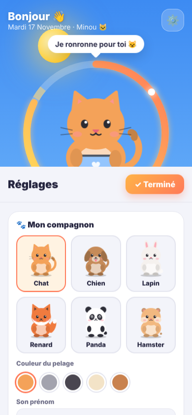
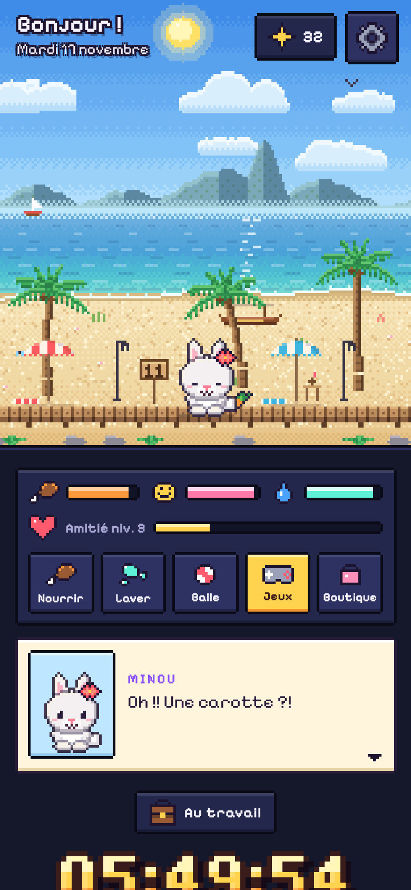
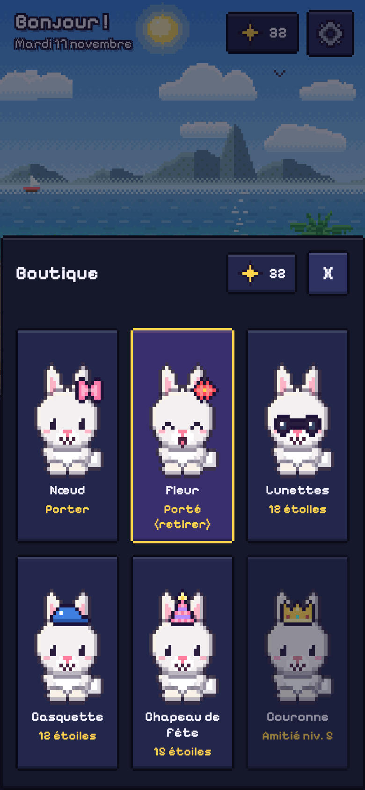
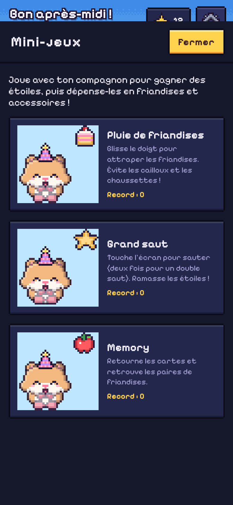
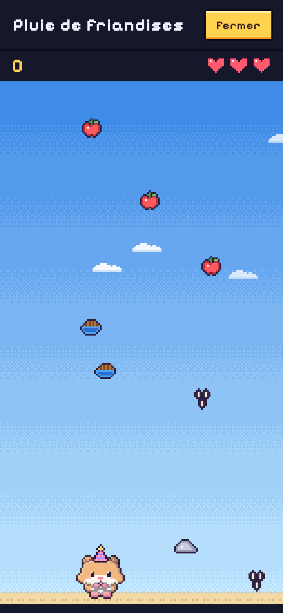

# 🏠 Bientôt la Maison

Application Android en **pixel-art** qui affiche le temps qu'il reste avant de quitter le travail et rentrer à la maison. Ton petit compagnon fait le trajet du bureau jusqu'à la maison au fil de ta journée.

<p>






</p>
<p>




</p>

## 📲 Installer

1. Télécharge **[`apk/BientotLaMaison.apk`](apk/BientotLaMaison.apk)** sur ton téléphone Android (8.0 ou plus récent).
2. Ouvre le fichier et autorise l'installation si Android le demande.
3. Au premier lancement, **autorise les notifications**.

> Les mises à jour s'installent par-dessus l'ancienne version (même clé de signature) : tes réglages sont conservés.

## ✨ Ce que fait l'appli

**Un décor vivant en pixel-art (dessiné à la main dans le code, 100 % original)**
- Deux décors : **Lagon** (plage, palmiers, île volcanique, pirogue, dauphins, crabes, voilier, phare) et **Campagne** (collines, moulin à vent, mare, sapins, papillons, feuilles d'automne).
- Le **ciel suit l'heure réelle** : aube, journée, coucher de soleil, nuit étoilée avec la lune et son reflet sur l'eau, et des étoiles filantes.
- La nuit, **les fenêtres et les lampadaires s'allument**, avec des lucioles.
- **Parallaxe** : fais glisser le décor du doigt pour l'explorer.
- Tout tourne en continu à 60 images/seconde.

**Ton compagnon**
- 6 animaux au choix (chat, chien, lapin, renard, panda, hamster), 5 pelages chacun, et le prénom que tu veux.
- Il **marche du bureau à la maison** au rythme de ton travail effectif, s'arrête aux **pauses** (parasol, banc, pique-nique), passe devant des **panneaux d'heures**, et :
  - cligne des yeux, remue la queue, sautille et regarde autour de lui ;
  - boit un verre pendant les pauses ;
  - s'excite quand la fin approche ;
  - fête la fin de journée devant la maison avec des **feux d'artifice** ;
  - dort la nuit (Zzz).
- **Touche-le** : il saute, fait parfois un salto ou une pirouette, envoie des cœurs, avec un petit son 8-bit et une vibration.
- **Touche le sol** pour l'appeler, **touche le ciel** pour une étoile filante ou un feu d'artifice.
- Il te parle dans une **boîte de dialogue façon jeu rétro**, avec le texte qui s'écrit lettre par lettre.
- Petite fête à **chaque heure terminée**.

**S'occuper de lui (version 2.1)**
- Trois besoins qui baissent doucement avec le temps, même appli fermée (moins vite la nuit) : **ventre**, **joie**, **propreté**. Il ne tombe jamais malade, il devient juste grognon : il réclame à manger, fait la tête, a des taches de boue…
- **Nourrir** : croquettes et pomme gratuites, son **plat préféré** (poisson, os, carotte, baies, bambou ou graines selon l'animal), glace et gâteau. La nourriture tombe devant lui et il la mange bouchée par bouchée.
- **Laver** : frotte-le avec le doigt pour faire de la mousse, un petit nuage le rince, puis il s'ébroue.
- **Balle** : il court la chercher et te la rapporte.
- **Amitié** : chaque soin et chaque partie le rend plus proche de toi (niveaux d'amitié).
- **Boutique** : nœud, fleur, lunettes de soleil, casquette, chapeau de fête et couronne, à acheter avec des étoiles. Il les porte partout : dans le décor, les jeux et ses notifications.

**Mini-jeux passe-temps (pour gagner des étoiles)**
- **Pluie de friandises** : glisse le doigt pour attraper les friandises et évite les cailloux et les chaussettes (combos ×2 et ×3).
- **Grand saut** : saute par-dessus les crabes, châteaux de sable, champignons et bûches (double saut) et ramasse les étoiles.
- **Memory** : retrouve les paires de friandises en un minimum de coups.
- Records, étoiles gagnées selon le score, et ton compagnon devient plus joyeux.

**Le compte à rebours**
- Gros chiffres pixel qui **roulent** à chaque seconde, avec une couleur différente selon le moment (travail, pause, presque fini, terminé, repos).
- Barre du trajet avec les pauses, heure de fin, prochaine pause, **travail effectif restant** (sans les pauses) et progression.

**Tout est réglable**
- Heures de début et de fin, jours travaillés, **horaires différents selon les jours**, horaires de nuit.
- Autant de pauses que tu veux (nom, heure, durée).
- Décor, ciel (selon l'heure, toujours jour ou toujours nuit), sons 8-bit, vibration, affichage des secondes.

## 🔔 Notifications

- **Compagnon** : c'est ton animal qui t'écrit, avec son portrait en pixel-art (et ses accessoires). Il te dit aussi s'il a faim ou s'il s'ennuie, et t'invite à jouer pendant tes pauses.
- **Classique** : des notifications sobres.
- **Aucune**.

Chaque rappel s'active séparément : début de journée, début et fin de chaque pause, 5 à 60 min avant la fin, l'heure de rentrer, et des rappels réguliers. Ils sont reprogrammés automatiquement après un redémarrage du téléphone.

## 🛠️ Compiler soi-même

```bash
./gradlew assembleRelease
# → app/build/outputs/apk/release/app-release.apk
```

Un workflow GitHub Actions (`.github/workflows/build-apk.yml`) compile aussi l'APK à chaque push (onglet *Actions*, artefact `BientotLaMaison-apk`).

Structure de `app/src/main/assets/` :
- `js/pets.js` : les compagnons, construits à partir de formes avec ombrage et contours automatiques.
- `js/scene.js` : le décor (ciel, parallaxe, lumières, critters, feux d'artifice) et le comportement du compagnon.
- `js/hud.js` : chiffres pixel qui roulent, boîte de dialogue, icônes.
- `js/care.js` : besoins du compagnon, nourriture, amitié, étoiles et boutique.
- `js/games.js` : les trois mini-jeux.
- `js/app.js` : réglages, calcul du temps, sons 8-bit, lien avec Android.
- `fonts/PixelifySans.ttf` : police pixel sous licence libre SIL OFL (voir `fonts/OFL.txt`).

Côté Android (`app/src/main/java/com/dupk/maison/`) : WebView en plein écran, alarmes (`Scheduler`), notifications (`Notifier`), redémarrage (`BootReceiver`).

## 🗄️ Ancien projet

L'ancien contenu du dépôt (script `veille_mayotte.py`) est archivé, intact, sur la branche **`archive/veille-mayotte-original`**.
