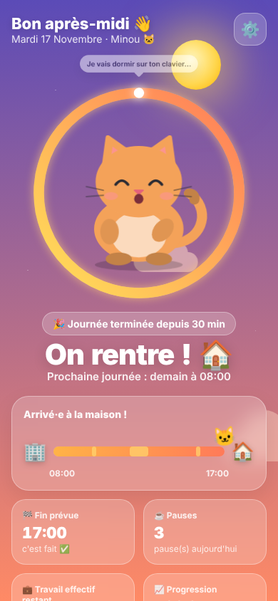

# 🏠 Bientôt la Maison

Application Android qui affiche **combien de temps il reste avant de quitter le travail et rentrer à la maison**, avec un petit compagnon animé qui vit ta journée avec toi.

<p>





</p>

## 📲 Installer

1. Télécharge **[`apk/BientotLaMaison.apk`](apk/BientotLaMaison.apk)** sur ton téléphone Android (8.0 ou plus récent).
2. Ouvre le fichier et autorise l'installation depuis cette source si Android le demande.
3. Au premier lancement, **autorise les notifications**.

> Les mises à jour s'installent par-dessus l'ancienne version (même clé de signature) : tes réglages sont conservés.

## ✨ Fonctions

- **Compte à rebours** en heures, minutes et secondes jusqu'à l'heure de départ, dans un anneau de progression où les pauses apparaissent en jaune.
- **6 compagnons animés** au choix : chat, chien, lapin, renard, panda, hamster, avec 5 couleurs de pelage et un prénom.
  - 💼 au travail : il tape sur son ordinateur
  - ☕ en pause : il boit son café
  - 🎒 presque fini : il sautille avec son sac
  - 🎉 journée finie : il saute de joie, avec des confettis
  - 😴 avant le travail ou jour de repos : il dort (Zzz)
  - Touche-le pour un câlin : cœurs, petite vibration et nouveau message.
- **Pauses** : autant que tu veux (nom, heure, durée). L'appli affiche la prochaine pause et le **travail effectif restant** (pauses non comptées).
- **Trajet bureau → maison** : ton compagnon avance sur la barre au fil de la journée.
- **Ciel animé** selon l'heure (aube, jour, crépuscule, nuit étoilée) : soleil, lune et nuages.
- **Horaires réglables** : début, fin, jours travaillés, et **horaires différents pour chaque jour** si tu veux (ex. vendredi 8h–12h). Les horaires de nuit sont gérés (fin le lendemain).

## 🔔 Notifications

Tu choisis le style :
- **🐾 Compagnon** : ton animal t'écrit (« 🐱 Miaou ! C'est la pause ! », « 🐶 Wouf !!! On rentre à la maison ! »…)
- **🔔 Classique** : notifications sobres (« Début de pause : Déjeuner », « Fin de la journée »)
- **🔕 Aucune**

Chaque rappel s'active ou se désactive : début de journée, début et fin de chaque pause, X minutes avant la fin (5 à 60 min), l'heure de rentrer, et des petits rappels réguliers (toutes les 30 min, 1 h ou 2 h).
Les rappels sont reprogrammés automatiquement après un redémarrage du téléphone.

## 🛠️ Compiler soi-même

```bash
./gradlew assembleRelease
# → app/build/outputs/apk/release/app-release.apk
```

Un workflow GitHub Actions (`.github/workflows/build-apk.yml`) compile aussi l'APK à chaque push (onglet *Actions* → artefact `BientotLaMaison-apk`).

Structure :
- `app/src/main/assets/index.html` : interface, animations et compagnons (SVG + CSS)
- `app/src/main/java/com/dupk/maison/` : WebView, alarmes (`Scheduler`), notifications (`Notifier`), redémarrage (`BootReceiver`)

## 🗄️ Ancien projet

L'ancien contenu du dépôt (script `veille_mayotte.py`) est archivé, intact, sur la branche **`archive/veille-mayotte-original`**.
